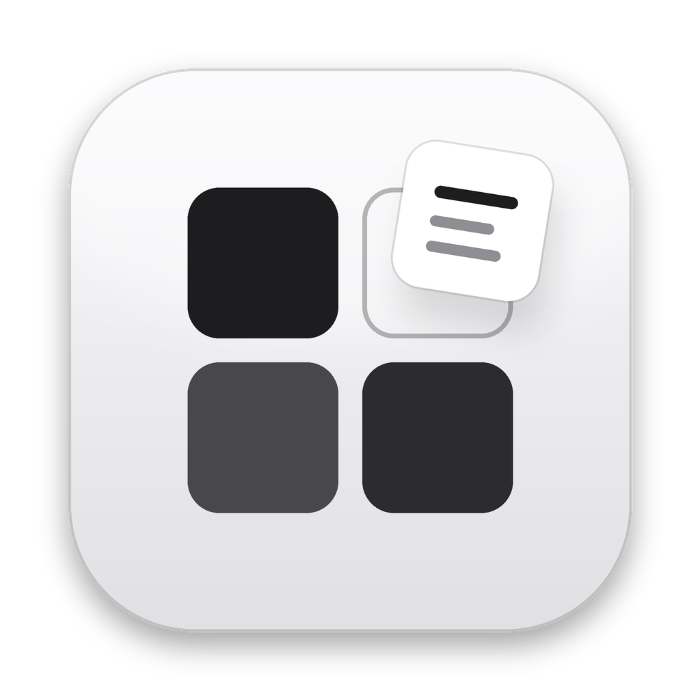

<p align="center"></p>

<h1 align="center">CV Blocks</h1>

<p align="center">A drag-and-drop CV builder. Snap sections and entries in and out, let it auto-fit to one page, export a clean PDF.</p>

---

## Download & install

Go to the **[Releases page](../../releases/latest)** and download the file for your computer:

| Computer | File |
| --- | --- |
| Mac with Apple chip (M1/M2/M3/M4) | `CV-Blocks-x.x.x-mac-arm64.dmg` |
| Mac with Intel chip | `CV-Blocks-x.x.x-mac-x64.dmg` |
| Windows | `CV-Blocks-Setup-x.x.x.exe` |

Not sure which Mac you have? Apple menu → **About This Mac** → look at "Chip".

### Mac
1. Open the `.dmg` and drag **CV Blocks** into **Applications**.
2. Open it from Applications. The first time, macOS will say it can't verify the developer (the app isn't signed with a paid Apple certificate). Click **Done**.
3. Open **System Settings → Privacy & Security**, scroll down, and click **Open Anyway** next to CV Blocks. You only have to do this once.

### Windows
1. Run `CV-Blocks-Setup-x.x.x.exe`.
2. If Windows SmartScreen appears, click **More info → Run anyway** (the app isn't signed with a paid certificate).
3. Follow the installer. It adds Desktop and Start Menu shortcuts.

## Using it

- **Library (left):** all your content. Drag a single block, or a whole section by its header, onto the page.
- **Remove:** drag a block back to the library, or hover it and click **×**. It stays in your library.
- **Reorder:** drag blocks within a section, or drag a section heading to move the whole section.
- **Edit:** click any block. Untick a bullet to hide it for this version without deleting it. Wrap words in `**double stars**` for bold.
- **Auto-fit:** spacing (and, if needed, text size) adjusts so the CV fills exactly one page.
- **Versions:** save the current arrangement (e.g. "Embedded roles") and switch back any time.
- **Duplicate:** make a variant of a block to keep two different wordings of the same job.
- **Export PDF:** button at the top right, or **⌘E** / **Ctrl+E**.
- **Start fresh:** the app opens with a sample CV (the fictional "Jake Ryan") so you can see how blocks work. **⋯ → Start a blank CV** clears it so you can enter your own details.

Your work is saved automatically on your computer. Use **⋯ → Download backup** now and then to keep a copy.

## For developers

```bash
npm install
npm start          # run the app
npm run dist:mac   # build .dmg files into dist/
npm run dist:win   # build the Windows installer into dist/
```

The whole interface is in `index.html`. `main.js` is the Electron shell, and PDF export uses Chromium's `printToPDF` with the page's print styles.

### Publishing a release

Pushing a version tag builds the Mac and Windows installers on GitHub Actions and attaches them to a draft release:

```bash
npm version patch      # bumps package.json, e.g. 1.0.0 → 1.0.1, and creates tag v1.0.1
git push --follow-tags
```

Then open **Releases** on GitHub, review the draft and click **Publish**.

## Credits

The CV design and sample content are adapted from [Jake's Resume](https://github.com/jakegut/resume) by Jake Gutierrez (MIT). Fonts: CMU Serif by Andrey V. Panov (SIL OFL 1.1). See [THIRD_PARTY_NOTICES.md](THIRD_PARTY_NOTICES.md).

CV Blocks is released under the [MIT License](LICENSE).
